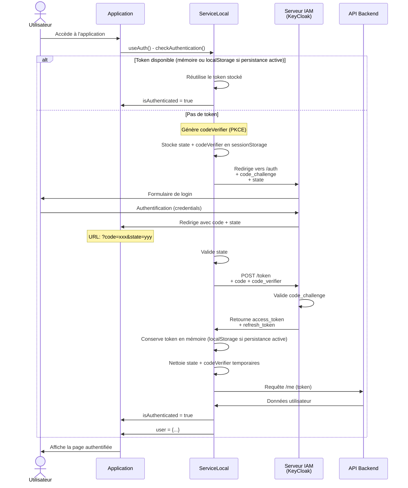
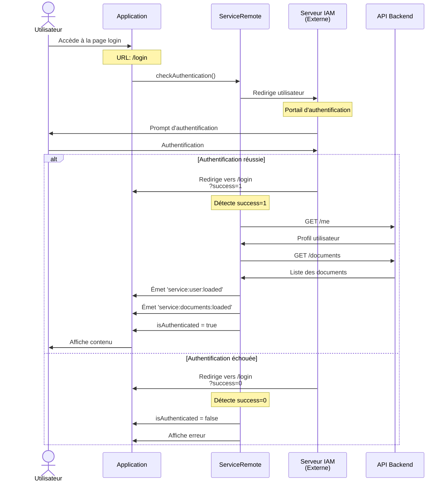
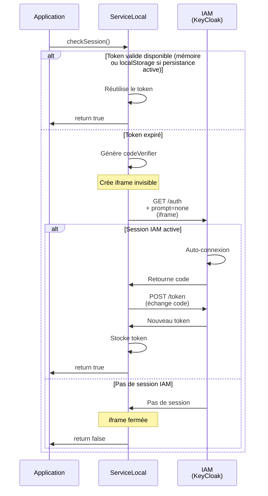

# Diagramme de Séquence - Authentification

## Vue d'ensemble

Ce document décrit le flux d'authentification du service. Il existe deux modes d'authentification : **Local** (OAuth2 avec PKCE) et **Remote** (IAM distant).

La persistance est indépendante du mode d'authentification : localStorage par
défaut, ou mémoire seule avec `configurePersistence({ mode: 'memory' })` avant
la création du service/store. Dans ce dernier cas, les jetons, le profil et les
documents sont perdus au rechargement. Le flux OAuth utilise toujours un
sessionStorage temporaire pour survivre à la redirection SSO.

---

## Mode Local (OAuth2 avec PKCE)



**Points clés:**
- **PKCE (Proof Key for Code Exchange)**: Sécurise le flux OAuth2
  - `code_verifier` généré et stocké temporairement en sessionStorage
  - `code_challenge` envoyé à l'autorisation
  - `code_verifier` transmis à l'échange de token
- **Token conservé en mémoire**, et persisté en localStorage seulement si la persistance est active
- **Refresh automatique** si token expiré

---

## Mode Remote (IAM Distant)



**Points clés:**
- **Redirection externe** pour l'authentification
- **Fetch des ressources** après retour réussi
- **Événements** pour notification des données chargées
- **Pas de stockage local** du token (géré côté serveur)

---

## Flux de Vérification de Session Silencieuse



**Points clés:**
- **SSO Silencieux**: Utilise `prompt=none` pour éviter le formulaire
- **Iframe invisible**: Vérifie la session sans redirection
- **Renouvellement automatique**: Si session active
- **Dégradation gracieuse**: Si pas de session, retourne false

---

## Stockage Persistant

Ce stockage est actif par défaut. Le mode `memory` le désactive et supprime
uniquement les anciennes clés localStorage de la librairie (`service`,
`codeVerifier`, `oauth2:state`, `oauth2:pkce`, `oauth2:pkce:*`). Un échec de
nettoyage empêche l'activation ; les clés tierces et le flux OAuth en cours dans
sessionStorage sont préservés. Après l'activation, aucun accès localStorage
n'est effectué par la librairie.

Les données OAuth temporaires sont supprimées après un échange réussi ou une
déconnexion. Les marqueurs techniques SSO en sessionStorage et les cookies IAM
ne sont pas affectés. Si l'application installe elle-même un plugin de
persistance Pinia, elle doit en exclure `service` pour respecter le mode mémoire.

```json
{
  "service": {
    "connexion": {
      "token": {
        "authenticator": "authenticator:oauth2",
        "access_token": "...",
        "refresh_token": "...",
        "expires_in": 3600,
        "token_type": "Bearer",
        "scope": "basic",
        "expires_at": 1730393104613
      }
    }
  }
}
```

---

## Callbacks et Événements

### useAuth Callbacks
```javascript
const { isAuthenticated, user, checkAuthentication } = useAuth({
  service,
  onLogin: () => { /* Utilisateur connecté */ },
  onLogout: () => { /* Utilisateur déconnecté */ },
  onError: (error) => { /* Erreur d'authentification */ }
});
```

### Events (ServiceRemote)
- `service:user:loaded` - Données utilisateur chargées
- `service:documents:loaded` - Liste des documents chargée

---

## Configuration Requise

### Variables d'environnement (IamSettings)
- `IamUrl`: URL du serveur IAM (KeyCloak)
- `IamRealm`: Realm KeyCloak
- `IamClientId`: ID client OAuth2
- `IamClientSecret`: Secret client (mode serveur)
- `IamEntrepotApiUrl`: API backend (mode local)
- `IamEntrepotApiUrlRemote`: API distante (mode remote)
